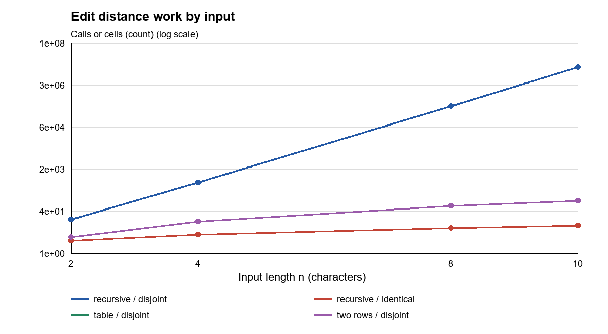
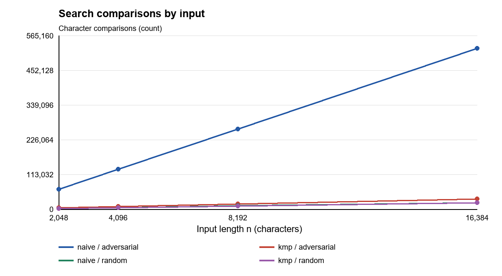
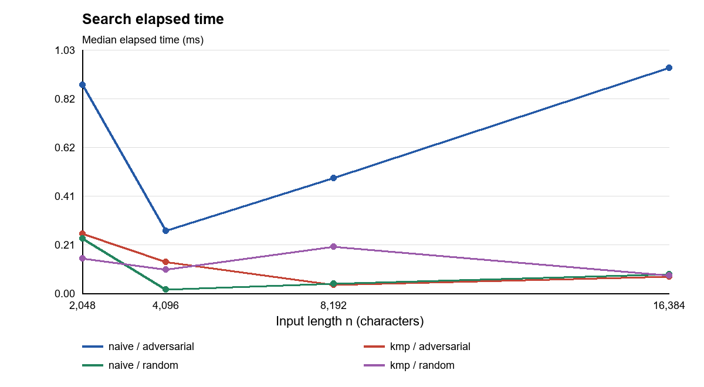

# Assignment 4 Dynamic Programming and String Algorithms

Pashanov Yelnur | SE2523 | Design and Analysis of Algorithms

## Experiment Design Card

Questions. How does edit-distance work grow for recursion and dynamic programming? How does pattern structure affect naive search and KMP?

Sizes. Edit distance: n = 2, 4, 8, 10 for equal-length strings; this fivefold range shows branching while keeping recursion practical. Search: text length n = 2,048, 4,096, 8,192, 16,384 with a 32-character pattern. Doubling the text separates growth from fixed overhead; the pattern is long enough to expose repeated comparisons and is held constant for a fair comparison.

Inputs. The generator uses seed 20261108. Edit distance uses random ACGT strings, identical strings, and disjoint A...A versus B...B strings, respectively showing typical behavior, the matching shortcut, and maximum branching. Search uses random ACGT strings and an adversarial text A...A with pattern A repeated 31 times followed by B; the latter forces repeated naive comparisons.

Metrics. Recursive calls reveal repeated subproblems; DP cell updates reveal table work; character comparisons reveal repeated checking in both search phases. All counters are incremented inside the algorithms. Calls and cells are different units, so their ratio is not a speedup. Time includes allocation and preprocessing but excludes input generation and CSV writing; five runs follow three warm-ups and the middle sorted time is reported.

Predictions. Recursive work should grow much faster on disjoint strings than the quadratic DP tables, while identical strings follow one branch. The adversarial search should cause roughly 32 comparisons per candidate for naive search; KMP should remain linear.

Plots. Edit work on a logarithmic axis compares growth; search comparisons reveal input sensitivity; median search time shows the observed timing. After exploratory runs, disjoint edit strings were added to expose worst-case recursion. Before the final rerun, edit sizes were changed from 4, 6, 8, 10 to 2, 4, 8, 10 to meet the fourfold-range rule.

## Plots and Results

The disjoint recursive case grows sharply, while both DP implementations perform n² cell updates and overlap on the graph.

At n = 16,384, naive search makes 523,296 comparisons on the adversarial input versus 32,798 for KMP.

The adversarial naive search has the highest median at n = 16,384, but short-run timings fluctuate.

## Prediction versus Result

Edit distance. The result supports the prediction: at n = 10, disjoint recursion made 12,146,179 calls, versus 100 cell updates for either DP method and 11 calls for identical recursion. Random recursion made 453,595 calls at that size. Thus input structure, as well as length, determines recursive work.

String search. At n = 16,384, adversarial naive search made 523,296 comparisons and KMP made 32,798, including LPS construction. On random input they made 21,713 and 20,459 comparisons, respectively. This agrees with the predicted adversarial advantage, although a fixed pattern length makes both curves linear in text length.

## Short Answers

Which input made search slowest? The adversarial text of repeated A and pattern ending in B produced the largest search time and comparison count for naive search at the largest size. Naive search checks 31 matching characters before failing at each candidate. KMP reuses the LPS values and does not move backward in the text.

How large could recursion handle? The largest measured equal-length input was n = 10, including the disjoint worst case. It took a median of about 22.068 ms and 12,146,179 calls. Larger sizes were not measured; repeated branching, rather than a proven hard limit, motivated the chosen bound.

## Short Answers Continued

What do two rows gain and lose? They reduce extra storage from O(nm) to O(m) while preserving the distance and O(nm) time. The full table is no longer available for directly tracing an edit sequence. Recovering that sequence would require extra work or another method.

Which search for the city platform? KMP is a sound default for long logs or repetitive text because its O(n + m) worst-case work is predictable and it finds overlapping matches. For short typical queries, naive search is simpler and may be competitive. The workload and fixed 32-character patterns here do not prove KMP is always faster.

## Time Measurements

On Windows with Microsoft OpenJDK 17.0.20.1, the n = 10 disjoint edit medians were 22.0683 ms (recursive), 0.0110 ms (table) and 0.0096 ms (two rows). At n = 16,384, search medians were 0.954 ms (adversarial naive) and 0.070 ms (adversarial KMP); random cases were 0.081 ms and 0.076 ms. Timings are not monotonic across all sizes, and tiny DP cases cannot establish a stable speed ranking. JVM compilation, scheduling and timer noise can outweigh small workloads; three warm-ups and five runs do not eliminate them. The counters provide repeatable evidence of work growth; reruns reproduce inputs and counts, not exact elapsed times.

## Correctness

Eight JUnit 5 tests check all reference values, empty inputs and patterns, overlaps, counters and 100 fixed-seed random cross-checks per family. Another 1,000 generated search cases compare each implementation with Java String.indexOf as an independent reference. Both families expose a common two-argument interface plus an instrumented overload.
